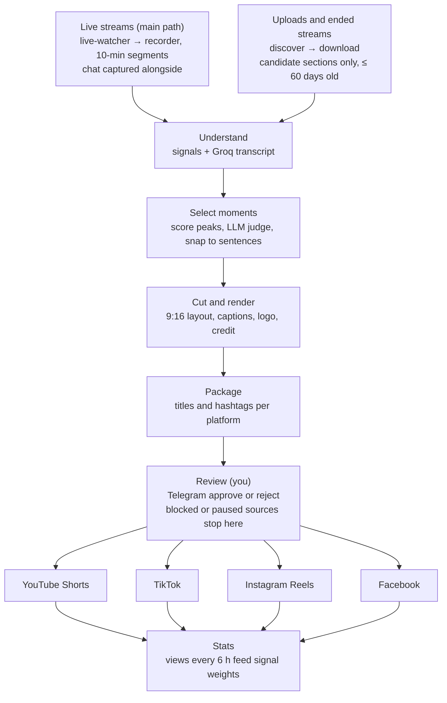
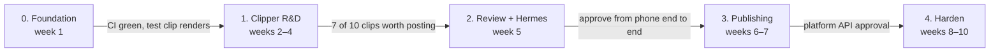

# Content Factory – Technical plan

How the system is built. What it must do lives in `docs/PRODUCT.md`; if the two disagree, PRODUCT.md wins.

## Goal and scope

Build a config-driven pipeline that turns live streams and long YouTube videos into vertical clips. Each clip is reviewed in Telegram and posted to YouTube Shorts, TikTok, Instagram Reels and Facebook.

- **Version 1:** a niche-agnostic clipper engine. Niches are added through config, not code, and each niche gets one brand used on all 4 platforms. Which niches run, and in what order, is set in the Execution plan.
- **Modes:** R&D runs every service end to end, including public uploads to separate test accounts, so both the pipeline and real clip performance get measured. Publish mode uses the real brand accounts. No permission proof is required: each source has a `clip_policy` (`open` by default, `blocked` if a creator objects). Any copyright claim, strike or creator objection pauses that source automatically and alerts you in Telegram. Every clip credits its source.
- **Success:** pipeline working end to end in ~6 weeks; first monetized account in 3–4 months.
- **Not in version 1:** AI originals and a clip-only SaaS (see Next expansion), a web UI (sources are managed through Hermes in Telegram and a small CLI; the web UI belongs to the future SaaS), multi-tenancy. The code is kept ready for them (see Scale-readiness) but none of it is built.

## Decisions log

| Area | Decision | Why |
| --- | --- | --- |
| Architecture | Python microservices: one repo, one container per service | Each service scales on its own; code is shared |
| Content model | One YAML profile per niche for tuning; sources live in the database, managed through Hermes in Telegram | Tuning is reviewed in git; sources change often and carry runtime state |
| Input | Live capture is the main path; uploads and ended recordings are secondary | Many recordings are deleted, privated or made members-only after a stream |
| Queue and broadcast | Redis 8 Streams | Consumer groups give both work queues and fan-out; license is fine for internal, unmodified use |
| State | PostgreSQL 18 | Many writers at once; works across machines later |
| Transcription | Groq `whisper-large-v3-turbo` (free plan, ~8 h of audio a day: one creator), local faster-whisper as fallback | Fast, near-zero cost, frees the laptop |
| Selection (MLBB) | Hybrid: signal peaks plus moments the LLM finds in the full transcript | Donation reads, announcements and tutorials don't spike chat or loudness |
| Creators | One at first; add more only after measuring real streaming hours | The Groq free cap, not the config, is the limit |
| LLM | The provider is chosen in config per profile: Claude, or any OpenAI-compatible API such as OpenRouter, Groq or a local Ollama | Claude is expected to judge Indonesian humor best, but a free or cheaper model may be good enough: measure the approval rate per model before choosing. A profile can list `fallbacks` (an ordered chain): a provider that fails is skipped for `cooldown_s` and the next one answers, and the call is priced as the model that answered. Free tiers are unreliable (in one session a Gemini model timed out, another returned 503, a free OpenRouter model returned 429), so a chain is the normal setup. Keys are env vars named in config; prices live in `llm_prices.yaml` so the budget stop sees the cost |
| Orchestration | Hermes Agent as operator: reports, status, allow-listed actions you confirm, config edits | It reads and advises; the scaler, reconciler and Docker act. No scaling, no account tokens, no shell |
| Test account that may become the brand account | Allowed: one Page or channel can be both `fb_test` (R&D) and `fb_mlbb` (publish). Daily caps and spacing are counted per destination (the Page or channel id), not per account entry, so two entries for the same Page share one cap | The operator may grow the R&D account and monetize it if it survives; per-account counters would let two entries double-post |
| Review | Telegram approval per profile or source (`review.required`, default on); the review service owns it | Quality control when you want it, fully automated when off; works without Hermes |
| Queue vs state | Postgres is the source of truth; Redis only carries job ids | A lost or stuck message is rebuilt from Postgres |
| Database driver | pg8000 (BSD-3) with SQLAlchemy and Alembic | psycopg is LGPL-3.0 and the project avoids copyleft dependencies; our volume is low, so a pure-Python driver is enough. Catch: pg8000 raises IntegrityError only for unique violations (check and foreign-key ones are ProgrammingError), so code reads `common.db.sqlstate(exc)` instead of the exception class. Type of a bare NULL parameter must be cast (`CAST(:x AS text)`) |
| Redis license | RSALv2, one of the three options Redis 8 offers (RSALv2, SSPLv1, AGPLv3) | Internal, unmodified use inside our own pipeline; we never offer Redis as a service to others |
| Hardware | Laptop on WSL2 now; used mini PC or VPS + laptop hybrid later | Free to start; home IP avoids YouTube bot blocks |
| Budget | ~$5–15 a month ceiling | Enforced by the cost ledger |

**Why Python only:** the core libraries are Python-first (yt-dlp, Streamlink, MediaPipe, PySceneDetect, librosa, Hermes Agent, the Groq and Claude SDKs). The heavy work runs in FFmpeg or external APIs, so another language wouldn't make it faster. One language means one toolchain, one CI pipeline and one shared `common/` library. Go would only save some memory in the light services, which version 1 doesn't need.

## System flow

Each hand-off between services goes through a Redis stream. Both inputs join at Understand; each approved clip is broadcast to all four publishers; stats feed back into how moments are scored.

1. **Live-watcher / Discover:** check each source for live streams and new videos; live streams go to the recorder (see Video types); videos already processed are skipped.
2. **Download:** yt-dlp fetches metadata, heatmap, chat replay and only the candidate sections (uploads and ended streams).
3. **Understand:** signal plugins score the video or segment in 10-second slices; Groq transcribes the candidate zones (`signals` mode) or every segment in full (`hybrid`).
4. **Select moments:** score peaks, plus moments the LLM finds in the transcript in `hybrid`, go through an LLM judge; cuts snap to sentence boundaries (see Transcript-first selection).
5. **Cut and render:** one FFmpeg pass makes the 9:16 layout, captions, hook, logo, source credit and normalized audio.
6. **Package:** title, description and hashtags for each platform.
7. **Review:** Telegram preview; you approve or reject. With `review.required: false` the review service approves at once and the clip goes straight on.
8. **Broadcast:** each approved clip goes to all four platform publishers.
9. **Publish:** each publisher posts to the accounts from `Profile.upload_accounts()` within their daily caps and posting windows.
10. **Stats:** views come back every 6 h and feed the signal weights.

### Discover rules: which videos, how often

Discover keeps the pipeline busy without reprocessing anything. Every value below is a profile setting.

- **First run (backfill):** for each source, take videos uploaded in the last `max_age_days` (default 60) that weren't processed yet, most-viewed first, at most `backfill_per_source` (default 5).
- **Schedule:** check each source every `poll_every_min` (default 30).
- **New uploads first:** a new video within the window always goes to the front of the queue.
- **No new uploads:** take the next most-viewed unprocessed video still inside the window, up to `daily_per_source` (default 2) a day. Older than the window is never picked.
- Videos shorter than `min_duration_s` or matching `title_exclude` are skipped.

**As built.** `services/discover` runs every `poll_every_min` and, for each source that is enabled, not paused or blocked and
not live right now, lists the channel's `/streams` and `/videos` (yt-dlp, flat), drops what the rules above exclude, reads the
page of the best few (public or unlisted only; members-only and private videos are never fetched) and queues one `download` job
per video, within the source's turn (`backfill_per_source` the first time, then `daily_per_source` a day). It does nothing while
the last 24 hours of Groq audio are above `discover.max_groq_day_share` of the daily limit, or while more than
`discover.max_backlog` download, understand or select jobs wait (jobs held back by an LLM quota count): live capture comes first. A long video is fetched in part,
`discover.max_window_min` long: the busiest stretch of YouTube's "most replayed" graph when it has one, else a stretch starting
about 15% in. `services/download` (an engine service) fetches that stretch at `download.max_height` (H.264 and AAC when offered),
cuts it into `live.segment_min` segments (streams copied when the keyframes allow, else re-encoded), stores them like a recording
and queues one understand job each, so everything after is the live path. The stream is recorded as `ended`, so the recorder
never touches it, and its clips go through the normal review and posting rules of the source.

### Video types: live streams and uploads

Live capture is the main path: most clips come from streams while they're live, because many recordings are deleted, made private or turned members-only after the stream ends. The ended recording only fills gaps.

| Status | Handling |
| --- | --- |
| Live now | live-watcher starts a recorder: Streamlink + FFmpeg save 10-min segments at 720p; chat-listener keeps how many chat messages came in each 10 s; each finished segment enters the pipeline at Understand |
| Upcoming | Re-check at its scheduled start |
| Just ended, processing | Already recorded live: nothing to do. Not recorded: re-check every 30 min for up to 24 h |
| Ended, recording public | Used only to fill gaps (missed start, connection drops) |
| Ended, recording gone or members-only | Nothing more to do; the live capture is the only copy |
| Regular upload | Normal flow: Discover → Download |

- **Detection:** live-watcher checks each source's `/live` page every 3–5 min with yt-dlp. That's free; the API's live search costs 100 quota units per call.
- **Signals while live:** chat speed (strongest), loudness, transcript. There is no heatmap.
- **Segment edges:** each analysis includes the last 2 min of the previous segment, so a moment split by a cut isn't lost.
- **No double clipping:** clip times are stored relative to the stream start.
- **Connection drops:** the recorder restarts by itself and logs the gap; at most ~2 min lost per drop.
- **Limits:** `max_concurrent_recordings: 3` on the laptop; ~2 GB per hour per stream at 1080p (about 1.2 at 720p); disk use is bounded by a 3 h rolling buffer.
- **Retention follows job state, not the clock:** a segment older than `max_buffer_h` is still kept while a pending job needs it (transcription backlog, render queue), up to the `max_hold_h` ceiling (default 12 h). A job still stuck at the ceiling is logged and alerted, not silently dropped.
- Members-only and private streams are never recorded.
- **Config:** `live: {capture, check_every_min, segment_min, segment_overlap_s, quality, max_buffer_h, max_hold_h, vod_fallback, vod_wait_h, skip_members_only}`.
- **Tools:** Streamlink (BSD-2, live only) and pytchat (MIT, unmaintained since 2022: if YouTube changes its chat it will break and the chat signal is simply missing). chat-downloader failed to parse a live page on 2026-10-27, and yt-dlp's live chat needs browser cookies (YouTube's bot check), so neither is used.

### Transcript-first selection

`selection.mode` is `signals`, `hybrid` or `transcript`. MLBB runs `hybrid`. Streamers read donation messages aloud, announce news and teach during the stream. None of that spikes chat or loudness, so the transcript is the only way to find it. Donations need no Saweria API and no OCR: the streamer reads them out, so they are in the transcript.

- **Transcribe once:** Understand sends each live segment to Groq (`signals.transcript.mode: full`) and stores words with stream-relative times in `transcripts`. The 2-min segment overlap reuses the previous segment's transcript instead of sending it again. Requests are at least 10 s (shorter ones bill as 10 s) and sent as small mono audio under Groq's 25 MB upload limit.
- **Live vs downloaded:** live segments use `signals.transcript.mode` (`full` for MLBB). Downloaded videos and ended streams use `vod_mode`, which stays `candidates_only` (driven by the heatmap), because a full transcript of a 4 h video would spend half of Groq's daily cap on one video and needs the whole audio instead of candidate sections.
- **Chunk pass:** Select cuts the transcript into chunks of about 5–10 min of numbered sentences and passes a rolling summary of the stream so far (`stream_context`). The LLM returns candidates as `{start_sentence, end_sentence, kind, reason}`. Code validates them against a schema, drops anything invalid and derives the times from the sentence ids. The model never writes timestamps.
- **One pool:** transcript moments and signal peaks are deduplicated by overlap in stream-relative time. The judge sees the pool with the summary and picks the final clips. Each clip keeps its `kind` and reason, and Telegram shows both.
- **Kinds:** `highlight`, `donation`, `tutorial`, `news`, `funny`. `selection.kinds` can give a kind its own `clip_length_s` (MLBB lets a tutorial run 30–75 s). Approval rate is tracked per kind.
- **Chat spikes (live):** the `chat-listener` service (`services/chat_listener`, pytchat) reads the public chat of every live stream whose profile has `signals.chat.enabled`, under its own lease (`live_streams.chat_worker`), and keeps only how many messages came in each `window_s` (10) seconds of wall-clock time in `chat_counts`: never a name or a text, so nothing personal is stored. Select maps the buckets of a segment onto the stream clock through the segment's stored time and finds stretches with at least `signals.chat.min_messages` in two buckets and `min_ratio` times the stream's usual rate (`services/select/chatspikes.py`). People react after they see something, so the event is `lag_s` before the burst. Each spike is put in front of the judge: the sentences spoken during it start with `[chat spike: N messages in S s]`, and a spike nobody spoke in becomes a line of its own, as long as the clip would be (`before_s` before, `after_s` after); the judge decides whether it is a fight, a donation or small talk. A silent segment with a spike is read too. Limits: a stream with a quiet chat (about 8 messages a minute on Rineeeloyyyeh) has few and small spikes; a segment whose chat was not listened to has none; thresholds were set before seeing a real busy chat and need tuning on real data.
- **Cut to the words** (`selection.trim`, `moments.trim_to_speech`): Whisper's sentence times start before the first word when there is silence or game sound first and end while sound goes on (measured on real clips 2026-10-28: 5 to 14 s without a word at the start, and 3 of 4 clips ending mid-sound). A chosen clip, and each moment of a recap, is cut to start `lead_s` (0.4) before its first word and end `tail_s` (0.6) after its last, never into the next word and never shorter or longer than its kind allows. `trim: null` cuts at the sentence times. Words Whisper dropped make the cut too tight, and sound without words (a silent streamer's fight) is cut off, so this suits talking streamers better than quiet ones.
- **Game names Whisper misheard** (`signals.transcript.glossary`, `transcript_fix` task, `services/select/glossary.py`): Whisper writes "Robby" or "Rubei" for the hero Ruby. When a clip is chosen (and for a recap), a small model reads the clip's words next to the glossary (hero names, items, game terms) and lists words that are clearly a glossary entry; each answer is checked (the entry must be in the glossary, look like the heard word and not be much longer, so "Hunter" never becomes "Hunter Strike") and applied as a whole-word replacement before the captions are drawn. It cannot bring back a word Whisper left out (the "stun" of one real clip was in none of four transcripts), and a model that cannot answer just leaves the words as they were. A long hero list in Whisper's own prompt was tried on 10-minute segments (2026-10-28) and did not make it spell them better. The glossary in mlbb.yaml is from memory: add the names Whisper gets wrong.
- **Titles with context** (`package`): the model that writes title, description and hashtags is also given what was said up to 45 s before and after the clip (`<before>`, `<after>`, read from the stored transcript), so it knows what the moment is about; it is told not to state a fact the words do not support. Recaps and clips with no stored stream get only their own words.
- **Hashtags for one platform** (`package.hashtags.platform_fixed`): `#fyp` and `#foryourpage` are added to TikTok captions only (`_defaults.yaml`), after the fixed tags every platform gets.
- **Made-up sentences** (`signals.transcript.ignore_phrases`): Whisper writes lines such as "Terima kasih telah menonton" from silence and game sound. A sentence that begins with one of the listed phrases is dropped with its words before it is stored, so it is never a caption or a moment for the judge.
- **Kill call-outs (off for MLBB):** `selection.callouts` can list shouted terms (`terms`), words that mean a viewer's message is being read (`ignore_near`) and how much to keep before and after (`before_s`, `after_s`); each term found becomes a `highlight` candidate with a fixed `score` even when the judge proposed nothing. MLBB does not use it: the game's announcer says "Solo kill" or "Mega kill" for any player of either team, and a quiet streamer's transcript is mostly the announcer and Whisper's hallucinations ("Terima kasih telah menonton!"), so the words say nothing about who made the play (three Rineeeloyyyeh clips from that, all rejected, 2026-10-26). The judge prompt says the same. Something that knows who got the kill (chat or loudness peaks, the kill feed on screen) is not built.
- **Untrusted input:** transcripts, including donor text read aloud, never become instructions. The LLM calls have no tools and their output is schema-validated. There is no content filter at the understanding stage. Your Telegram review is the check before anything is posted.
- **Groq budget:** the free plan allows about 28,800 audio s/day, 7,200 s/hour (2× real time) and 20 requests/min, per organization (verify in the console; one account only). One live stream is 1× real time, so one creator fits under the hourly cap, and under the daily one if they stream about 8 h or less. Seconds sent are counted in the cost ledger, an alert fires at `alert_at` of the daily limit, and at the limit transcription uses `fallback_engine`, or selection runs on signals only if that is `none`. A priority queue and a stepwise degrade order are not built: they come with the second creator.

### Match recaps (one video from the best moments of one match)

`compilation.enabled` (profile) turns this on; MLBB has it on. After each segment's ordinary clips, the select service asks the LLM two things, always by sentence number (it never writes a time):

1. **Which matches have finished** in the last `match_window_min` (45) minutes of the transcript. A match is a stretch of at least `min_match_s` that ends with its result. Matches already known (table `matches`, kept whatever the outcome) are not asked about again.
2. **Which moments of a new match to use**: `min_moments` to `max_moments` moments of `moment_s` seconds each, adding up to `length_s` (60-170 s by default, so a recap fits YouTube Shorts' 180 s). Code derives the times from the sentences, drops anything out of range, overlapping or over the length, and returns the moments in the order they happened.

The recap becomes a `render` job of kind `recap` whose input is a list of **pieces** (file, start, end), found from the `segments` table, so a moment that crosses a 10-minute cut uses two files. Render joins the pieces into one source (each scaled to the first piece's size and rate, re-encoded once at high quality), then runs the ordinary render on it: layout, captions (re-timed onto the recap's own clock), hook, loudness. It then goes through package, review and publish like any clip. The step is best effort: if it fails, the segment's ordinary clips are kept and the next segment tries again. The recordings a recap needs are kept by retention until it is rendered.

Limits: Facebook accepts a Reel of at least 5 minutes through the API (tested 2026-10-24; Meta's docs say 90 s), YouTube Shorts allow 3 minutes. Recaps of mixed matches are not built.

### Cut and render

`services/render` makes one 1080×1920 clip per FFmpeg pass from a source window (`render_clip(profile, source, start_s, end_s, out)`).

- **Layouts:** `center` (a 9:16 column from the middle), `blur_fill` (the whole frame, sharp, over a blurred copy) and `split` (cam panel on top, gameplay below; `split_ratio` is the cam panel's share of the height). `facetrack` is a full-height 9:16 window that follows the largest face (MediaPipe Tasks FaceDetector, about 4 samples a second of the clip's own stretch): steady while the face stays put, a smooth follow when it moves, an instant snap on a camera cut (`services/render/facetrack.py`). It follows the largest face, not the active speaker.
- **Boxes:** `layout.cam` and `layout.main` are written for a 1080-pixel-high frame and scaled to the real source. Sizes are made even, and a box that pokes more than 2 px outside the frame is rejected, never silently nudged.
- **Encoder:** the profile's `video_codec` is a preference. NVENC is tried once with a tiny encode and libx264 is used when it fails (no GPU, driver missing).
- **Loudness:** single-pass `loudnorm` to about -14 LUFS, switchable with `output.loudnorm`.
- **Safe by construction:** the command is an argument list (no shell); inputs are limited to local files (`-protocol_whitelist file`), so a playlist inside an untrusted file cannot make FFmpeg fetch a URL; the clip is written to `<name>.part` and renamed, so a half-written clip never has the final name; the window is checked against the source length and the 180 s ceiling before anything runs.
- **Overlays:** the logo sits in a corner of the safe zone; captions, hook and credit are one ASS subtitle file drawn by FFmpeg. Captions are `word_pop`: a line of up to `max_words_per_line` words, the spoken word highlighted and popping for a moment. Line breaks and font sizes come from the real font's measurements, so a line always fits between the safe margins and a word too wide for the screen is shrunk, not cut. `captions.y`, the hook and the credit are checked against the safe zone, and a position outside it is an error.
- **Untrusted text:** transcript words, the hook and the credit never reach the subtitle file as written: braces, backslashes and control characters are removed, so spoken text cannot inject override codes (a test renders hostile words and checks the pixels).
- **Assets:** a font or logo that is switched on but missing fails the render with a message saying what to add; nothing falls back to a default look. See `assets/README.md`. The MLBB profile ships with the logo off until there is one.
- **Captions timing** (`captions.reveal`, `captions.offset_s`): by default a line fills up word by word (`reveal: progressive`), anchored at the left edge where the finished line starts, so no word is shown before it is spoken; `reveal: line` shows the whole line at once. `offset_s` (0.10 s) shows every caption later than Whisper's word start, which tends to be early. Measured on 4 real clips (2026-10-28) by comparing caption times with the audio level, the offset was 0.0 to 0.05 s on ordinary clips and 0.15 to 0.35 s (early) on recaps; this is energy against words, not a listening test, so tune `offset_s` by watching clips.
- **Bad words** (`profanity` in the profile, `services/render/profanity.py`): each listed word that the transcript has is muted in the clip's audio (`volume=0` for its time, a little before and after: `pad_before_s`, `pad_after_s`) and shown in the captions as its first letter and stars. MLBB lists Indonesian and English words; a profile with no `terms` is untouched. Limits: it only knows what Whisper wrote down at the times Whisper gave, so a word it left out or heard as something else is not muted; the title, description and hook texts written by the LLM are not filtered.
- **The handler** (`services/render/handler.py`): reads `jobs.data["render"]` (source key, window, hook, words, written by select), renders with the job's `spec` snapshot, stores the clip as `clips/<job id>.mp4` in the media store (a re-run replaces it), records the output details in `data`, and hands the job to `package`.
- **Seeking:** the source is seeked to 12 s BEFORE the window and the exact start is cut inside the filter graph (`trim`, `atrim`; `services/render/seek.py`). A plain input seek into an MPEG-TS with sparse keyframes lands late, the audio starts on time and the video waits, and the first frame was repeated for seconds while the sound played. The recap joiner and the face finder use the same rule.
- **Menus and donations (`split` only):** `layout.wide` pans the gameplay panel across the whole width while a full-screen menu (draft pick, loading screen: no green, found by a colour measure at 2 frames a second) is on screen, so the team lists and "Global No." popups can be read. `layout.donation` is the box of the stream's donation alert on the 1080-high frame; in a `donation` clip it is copied to the top middle of the gameplay panel, but only while the alert's yellow message text is on screen (`services/render/scenes.py`). The thresholds are in the profile.
- **Preview:** the Telegram preview is 720×1280 with a bitrate cap that falls with the clip's length, to stay under the bot upload limit of about 50 MB.
- **Verified by checking pixels, not by eye:** text lands inside the safe zone, a caption is on screen exactly while its word is spoken, the logo sits in its corner at the configured width and opacity. "Plays on all four platforms" is covered only by format (1080×1920, h264 yuv420p, aac, faststart); a real upload test per platform comes with the publishers.

### Scout: finding channels automatically

A scout service runs weekly for each niche. It finds the channels whose recent videos got the most views in the last 30 days, so the source list isn't limited to the links typed into config.

- Searches with the niche's keywords and region (e.g. Indonesia) through the YouTube Data API, ranks recent uploads by views, then totals views per channel.
- Each search uses 100 of the API's 10,000 free daily quota units, so ~20 searches a week per niche costs nothing (needs verification).
- Suggestions go to Telegram with views and upload frequency. Approved channels join the profile and start in R&D mode.
- Config: `scout: {enabled, run_every_days, keywords, region, lookback_days, min_channel_views, max_suggestions}`.
- Built in phase 2.

## Services

Seventeen containers, all Python, sharing one `common/` library, plus Hermes Agent, Redis 8 and PostgreSQL 18. Each reads from one stream, does its job and writes to the next.

| Service | Reads | Writes | Scales by |
| --- | --- | --- | --- |
| live-watcher | timer (every 3–5 min) | `stream.live` | fixed 1 |
| recorder | `stream.live` | `segment.ready` (into understand) | one per live stream, max 3 |
| chat-listener | `stream.live` | message counts per 10 s in Postgres (`chat_counts`, no authors or texts) | one per live stream |
| discover | timer | `video.found` | fixed 1 |
| download | `video.found` | `video.downloaded` | queue depth |
| understand | `video.downloaded`, `segment.ready` | `video.understood` | Groq rate limit |
| select | `video.understood` | `clip.selected` | LLM rate limit |
| render | `clip.selected` | `clip.rendered` | CPU/GPU |
| package | `clip.rendered` | `clip.packaged` | LLM rate limit |
| review | `clip.packaged` | `clip.approved` | fixed 1 |
| publisher ×4 (shorts, tiktok, reels, facebook) | `clip.approved` (own consumer group each) | `clip.published` | fixed 1 each |
| stats | timer | Postgres | fixed 1 |
| scout | timer (weekly) | Telegram suggestions | fixed 1 |
| scaler (+ reconciler) | stream lengths, Postgres | worker counts, re-published jobs | fixed 1 |

**Publishers:**

| Platform | How it posts | Notes |
| --- | --- | --- |
| YouTube Shorts | Data API `videos.insert`, direct file upload | Default quota 100 uploads/day per project; test one upload from the unverified project first |
| Facebook Page | Graph API, direct file upload | Needs a Page, not a profile |
| Instagram Reels | Graph API `media_type=REELS` with `video_url` | The video must be at a public URL: staged in Cloudflare R2 behind a signed link (60 min), deleted after publishing; ~100 API posts/day per account (one doc section says 50) |
| TikTok | Assisted: the approved clip (as a file) and its caption go to your Telegram and you post from the TikTok app (`services/publisher/tiktok_assisted.py`, `tiktok.posting: assisted`). The Content Posting API (Direct Post) is not built: it posts publicly only for audited apps, and unaudited ones are private-only, up to 5 users a day, and TikTok's review rules do not favour a personal tool. A sandbox with private posting is the next step if wanted. | Never automate the website or app. Without R2 a clip over the bot upload limit goes as a lighter copy; with Cloudflare R2 (`media_host` in accounts.yaml, keys in .env) the clip is stored as it is for `max_age_h` and you get a download link and a Delete file button (the review service records the press, the TikTok publisher deletes; above `max_total_gb` clips go as files again). |

## Config model

Content (what to clip and where it goes) lives in profile files; load (how many workers run) lives in a separate file. See `config/README.md`.

| File | Holds |
| --- | --- |
| `config/profiles/_defaults.yaml` | Every setting with a comment; the reference |
| `config/profiles/<niche>.yaml` | Live capture, discover, scout, signals, selection, layout, branding, targets and test_targets. Its `sources:` list only seeds an empty database |
| `config/hermes.yaml` | What Hermes may edit: files, denied keys, source actions, backups kept |
| `config/accounts.yaml` | Test and brand accounts, daily caps, posting windows; names env vars only, no secrets |
| `config/workers.yaml` | Worker counts per service and host, Groq rate limits |

- **Merge order:** defaults → profile → per-source overrides.
- **Sources live in the database** (`sources`: url, name, enabled, `clip_policy`, overrides such as `layout.cam`, plus `paused_at`, claim count, last poll, `updated_by`). The loader merges the profile YAML with each row (`load_profile(path, sources=rows)`) and stores the result in `jobs.spec`. A row is validated by the same pydantic models when it is written; a bad row that slips in is skipped with an alert. The YAML `sources:` list only seeds an empty database. A small CLI (`factory sources add | list | pause | resume`) calls the same validated functions as Hermes, so sources can be managed when Hermes is down.
- **Upload gate:** `Profile.upload_accounts()` returns test accounts in `rnd` mode, brand accounts in `publish` mode, and nothing for `clip_policy: blocked` or disabled sources. The publisher also skips sources paused in Postgres. Every clip needs your Telegram approval unless the profile (or one source's `overrides`) sets `review.required: false`; `Profile.needs_approval()` is what the review service calls.
- `config/config_schema.py` validates everything; Hermes must run it before saving any change.
- **Config location:** `CONFIG_DIR` points the loader at another folder (default `config/`). Before the repo goes public, the real profiles, accounts and prompts move to a gitignored `config.local/` or a private repo and only placeholders stay in the repo. The loader reads YAML today; a database-backed repository can use the same pydantic models later.

## Data and messaging

Redis carries the hand-offs between services; Postgres holds the record of what happened. Video files stay on disk.

**Message rules**

- A message carries only a job id (JSON with a schema version); workers load the details from Postgres.
- Every worker must handle the same message twice without harm, because Redis can redeliver after a crash.
- Three failed attempts move the job to a dead-letter stream and send a Telegram alert.

### Telegram rooms, commands, health and pauses

**Rooms.** One Telegram group with Topics turned on, four topics (`config/telegram.yaml`; `make telegram-rooms` finds the ids and creates missing topics): `approval` (the clip previews with Approve/Reject, and the TikTok files to post), `alerts` (what needs a person), `monitoring` (service health and a digest every `health.digest_every_h`) and `commands` (where you type). Every sender goes through `common.rooms.Rooms.where`; without a group, messages go to each allowed user's private chat as before. A topic that is not set falls back to the group's General topic.

**Commands** (`services/review/commands.py`), from an allowed user id in a private chat or in the commands topic, only when the message is exactly one command word (free text is never read; a stranger gets no answer): `/status` (jobs per stage by what they are doing, clips waiting for you, Groq use and whether transcription is stopped, LLM pause, what is paused, services up, who is being recorded, which accounts have clips waiting and why), `/health` (each expected service: up, DOWN or never seen), `/posts` (today's posts per account against its cap), `/budget` (the month's OpenRouter budget: cap, spend, stop, what is left per day) and `/budget 25` (any amount, parsed strictly as the one thing besides a command word that is read; it asks, and a Yes tap changes the cap), `/dead` (the newest dead jobs, each with a Requeue button), `/pause` and `/resume`, `/help`. They read Postgres and the cost ledger. "Recording now" counts only a recorder that checked in within 2 minutes.

**Health.** Every service writes a row to `heartbeats` every 30 s (`common/heartbeat.py`). The watchdog in the scaler (`services/scaler/monitor.py`) reports a service quiet for more than `health.stale_after_s` to the alerts room (once), says in the monitoring room when it is back, and posts the digest. A service never seen is reported after a 5-minute grace. It cannot watch itself: Docker's restart policy covers the scaler. Nothing reaches into Docker.

**Rules from Telegram.** The posting rules are `accounts.yaml` `defaults` (`daily_cap` per account, `min_spacing_min`, `post_windows`) and `selection.clips_per_day` (profile defaults); `/cap`, `/spacing`, `/window` and `/clips` with one value store a replacement in `settings` (`rules.daily_cap`, `rules.min_spacing_min`, `rules.post_windows`, `rules.clips_per_day`) after a Yes tap, and `/rules` shows what is in force and who set it. The publishers read the stored values every time they decide whether a clip may go (`common.rules.apply`), and select reads `clips_per_day` before it asks a model, so a change works at once with no restart. Every value is checked against `workers.yaml` `rules.ceilings` (what Telegram can never go above, by hand only). A "day" is a rolling 24 hours: the cap counts an account's posts in the last 24 h because the platforms do, and a midnight reset would let a full cap go out just before it and another just after. `clips_per_day` is the same window; a rejected clip gives its place back. Clips go to every account, so the clip limit and the cap should be about equal: more clips than the cap only queue up. When the limit is reached nothing more is made (no model is asked) until older clips leave the 24 hours; it takes the first clips of the day, not the best, so a higher `min_score` is the way to be stricter about quality.

**A Facebook Reel Facebook cannot read yet.** Right after a Reel is finished, Facebook can answer code 100 ("object does not exist") for a moment although the Reel is published (seen on 2026-10-28, a clip marked failed that was live). Once the session is marked `finished`, that answer means "not ready": the post stays `uploading` and the next sweep looks again; before the Reel is finished the same answer is still an error.

**Pauses.** `/pause` offers posting, new live recordings (`live`: live watcher, recorder and chat listener), discovery of ended streams (`ended`: discover), intake (both of those at once; recordings under way go on) and each running source; each asks for a confirm. `switch:publish` and `switch:intake` are rows in `pauses` with no end time, so a restart does not undo them. A paused source uses `sources.pause`; one paused after a claim (FR-10) is never resumed from the chat. `/resume` is one tap.

### Job handling and recovery

**Transcription fallback.** `understand` goes to OpenRouter's `openai/whisper-large-v3-turbo` (`OpenRouterTranscriber`, the OpenAI SDK pointed at OpenRouter, `verbose_json` with word and segment timestamps) when Groq's rolling use would pass `stop_at` or Groq answers 429, if `signals.transcript.fallback_engine` is `openrouter`, the key `OPEN_ROUTER_KEY` is set and the OpenRouter budget is not stopped. It is announced once (`pauses` key `stt:overflow`), recorded as provider `openrouter` with the cost OpenRouter reports in `usage.cost` (so it counts against `/budget`), and any refusal (402, 403, 5xx, network) leaves the segment waiting for Groq as before. Facts from OpenRouter's STT docs, checked 2026-10-25: it also takes OpenAI-style multipart uploads (25 MB cap; our 10-minute Opus segments are about 2 MB); the 60 second limit is upstream processing time per request, not audio length (a 130 s clip took 4 s); `order`/`only`/`ignore` are not applied to transcription, so the provider cannot be pinned (it chose DeepInfra, at about $0.012 per audio hour, every time; Groq's endpoint there costs about $0.04); the plain `prompt` is ignored. On one 20 s sample of mixed Indonesian and English slang its text was clearly less accurate than Groq's (similarity 0.58 to Groq-with-prompt, and an invented closing "Terima kasih"), and neither auto language detection nor a DeepInfra prompt option changed it; local faster-whisper with the vocabulary prompt scored 0.87 but ran at 2.7 times real time and about 1.7 GB RAM. Not built: faster-whisper as an engine.

**Donation card on every layout, and sharper enlarging.** The stream's donation alert (measured per source in `layout.donation`) is shown in a `donation` clip for as long as its yellow message text is on screen, centred and `donation_width` of the frame wide, on every layout: on `split` at the top of the gameplay panel, on `center`, `blur_fill` and `facetrack` at `donation_y` (18%) of the way down, between the hook and the captions. Only the menu scenes (`layout.wide`) stay split-only. `layout.scaler: lanczos` and `layout.sharpen: 0.8` (a light luma-only sharpen of the face cam panel) are the defaults for every niche; on 2026-10-26 two sharpened variants of the same 10 s of Leo's stream were judged better than the plain one on real footage (the face cam is only 572 px wide in the stream and is enlarged 2.4 times, which no bitrate can fix). Showing the whole cam (`split_ratio: 0.317`, enlarged 1.9 times) is a further option, not the default.\n\n**The stored copy and the approval.** `review/<job id>.mp4` in R2 is the one full quality copy of a clip. When the review service sends a clip for approval it uploads that file first (`ClipStore.put`: skipped, with a log line, when R2 is down or holds `max_total_gb`; the approval then goes out without the link) and adds a "⬇ Full quality" link button to the message (Telegram buttons whose data is an https address open it; the link is signed and valid `link_ttl_min`, 2 days). A tap on Reject deletes the copy at once, an unanswered review deletes it when it expires, and Approve sets `hosted_files.keep_until` to now plus `media_host.keep_after_approval_h` (24) and leaves the link on the message. The sweep (`ClipStore.sweep`, every poll of the review service and in the TikTok publisher's housekeeping) deletes whatever is past its `keep_until`, asked for, or older than the `max_age_h` ceiling (48). TikTok and Instagram call `ClipStore.store`, which reuses the copy and only uploads when it is gone (a clip that needed no approval, or posted after a day), so one clip is uploaded once. Migration 0014 adds `hosted_files.keep_until`.

**Instagram through a signed link.** Instagram's resumable upload does its processing inside the final upload request, which Instagram ends after about 48 s with `ProcessingFailedError` / "Request processing failed" (`retriable: false`). Our 1080p60 clips of about 50 s and more miss that deadline most of the time, and a failed container stays "in progress" forever (measured 2026-10-26: one 51 MB clip failed 7 of 10 uploads, and a 26 MB re-encode of it 3 of 5, so it is not the file size, nor the caption, nor the audio rate). With `instagram.upload: r2` (`accounts.yaml`), `InstagramPublisher` takes the stored copy of the clip in R2 (storing it first if it is not there), makes the container with `video_url` (a signed link valid for 1 h), and Instagram fetches and processes it in the background (3 of 3 finished in 41 to 52 s). The link is to the shared stored copy above, which is deleted by its own rule (not by the publisher). A container still processing is waited for and the retry reuses the saved container. `resumable` stays available as a setting and is used when the R2 variables are missing.

**Transcript hygiene.** The cheap OpenRouter Whisper provider sometimes loops (`ETSSSS…` of 154 characters, `kususus…` of 128). Any run of a 1 to 4 character unit repeated 5 or more times is shortened to 3 repeats, and a word still longer than 40 characters is left out, instead of the whole 10-minute segment being refused. A sentence or word that ends up to 15 s past the end of the audio is cut back to the end (a 154 s clip had a sentence ending at 160.97 and the segment died); one that starts after the audio ended is left out; far more than that is still refused as a broken reply. Paid overflow to OpenRouter's Whisper is only for the stream being recorded (`live_streams.status = 'live'`); segments of a finished stream wait for Groq.

**Cheap reasoning models and empty replies.** DeepSeek v4 flash and Qwen 3.7 flash think silently before they answer, the thinking counts against `max_output_tokens`, and how much they use varies from run to run. Measured 2026-10-26 on the real 332-sentence recap prompt: with 4096 tokens Qwen spent all of it thinking and the reply was empty ("returned an empty reply"), DeepSeek ran out about half the time; with 16000 they answer but used up to 12,000 tokens and 3 minutes; Haiku answered in 5 s with 682 tokens. So they are backups with `max_output_tokens: 16000` and `timeout_s: 300`, and Haiku is first for the recap match finder. OpenRouter's `reasoning: {"enabled": false}` makes both answer in 3 s with about 130 tokens (Qwen agreed with Haiku, DeepSeek drew the boundaries differently each run); `effort: low` did nothing. Not built: a `reasoning` setting on the LLM spec (it needs a schema change, so a restart of every service).

**Recap join, one piece at a time.** `assemble.join` cuts each piece with its own ffmpeg process, one input, to MPEG-TS on the media disk (`render-tmp/`), and joins the finished pieces by stream copy (concat demuxer). The earlier single process with a concat filter opened every piece at once and queued the later pieces' frames while playing the first; at 1080p60 that filled the 1.5 GB container and the join was killed (signal 9) with only decoder warnings in the log. Measured on six real pieces: 89 s, 136.6 s of video, peak memory 870 MB. The render container's `/tmp` is 512 MB of memory (a recap's joined source is about 150 MB).

**Clip audio is 48 kHz.** The render passes `-ar` (`output.audio_sample_rate`, default 48000) because `loudnorm` works at 192 kHz inside and the encoder kept 96 kHz, which Instagram refused after the upload (`ProcessingFailedError`; its Reels limit is AAC at 48 kHz at most, measured 2026-10-25: three 96 kHz clips failed, with the same render otherwise). Recaps already resample to 48 kHz in `assemble.py`.

**Minimum recording quality.** `live.min_quality` (480p, 720p or 1080p; default 720p, never above `live.quality`) is passed to Streamlink as an extra `--stream-sorting-excludes` entry (`<720p`). A finished stream that YouTube is still processing offers only 360p for hours, and after a long stop the recorder would catch up on the missed hours at that quality (measured 2026-10-25: 33 segments of 360p, 5.5 hours). With nothing at or above the minimum Streamlink stops with "the specified stream(s) 'best' could not be found", the recording fails, and `run_stream` settles the stream as `ended` (no segments) when it is over, or tries again later while it is still live, since better qualities often appear a little later. The hours are then left to the download path (discover/download) at 1080p.

**The hours planner.** `planner` in `workers.yaml`, `services/understand/planner.py`, called by the understand stage before a segment goes to Groq. It makes a segment WAIT (`jobs.Deferred`, no attempt used, re-checked in 10 or 30 minutes), never fail, and never alerts: (1) the day's Groq audio up to `stop_at` is shared fairly between the ACTIVE sources (sent audio in the last 24 hours, or a segment waiting now, so a silent source does not shrink anyone's share); a source over its share waits only while another source below its share has segments waiting, so nothing is held back when nobody needs it; (2) what is left to spend today of the OpenRouter budget (an even share of what was left below the stop when today began, less today's spend) is turned into audio seconds at the cost of an hour of audio, measured from the ledger over the last week once `min_measured_hours` of audio were sent, otherwise `assumed_cost_per_audio_hour_usd`; a segment waits when that is used up. Free models measure as almost nothing, so the money limit only binds when paid models are in use. `/budget` shows the plan. Not built: weighting sources by their approval rate, and sending the segments with the strongest signals first when audio is short.

**Reject reasons.** A Reject tap rejects the clip at once; the caption then asks "Why? (optional)" with a fixed list of reasons (boring, starts or ends badly, bad crop or layout, unclear speech, not suitable, same as another clip, other) and Skip. The first reason is kept in `data.review.reason`, only for a rejected clip, and `make model-scores` counts them per LLM, so a model that picks boring moments or a layout that crops badly shows up in the numbers.

**A model per task.** `selection.llm_judge` picks the moments. `selection.llm_tasks` may give `recap_match` (which match has finished: the call that reads the most transcript), `recap_pick` (which moments of a match) and `package` (titles and captions) a model and backups of their own; a task not listed uses the judge. The general setup is in `_defaults.yaml`, so every profile has it and only names its own prompt: the judge, `recap_match` and `recap_pick` are Claude Haiku 5.5 through OpenRouter and `package` is Qwen 3.7 flash, each with paid backups and then Gemini's free tier or an OpenRouter free model last (a test requires every chain to end on a free model, so empty credit never stops the pipeline: the paid ones fail and the next answers). Until the key has credit every call tries the paid model first and falls back; a failed provider is skipped for `cooldown_s`, but the client is rebuilt per job, so that is one failed request per job. Each task's chain has its own quota pause and its own price check (every model needs a line in `llm_prices.yaml`), and `make llm-check` tries every chain. The recap step asks through the gate itself, so a chain that runs out pauses only that chain and the step waits.

**The OpenRouter budget.** `budget.openrouter` in `workers.yaml` gives a starting monthly cap, a ceiling that is only a guard against a typo or a stolen Telegram account (raise it by hand when the budget grows; set the same limit on the key at openrouter.ai: that is the hard stop), `alert_at` (0.8) and `stop_at` (0.9). The live cap is the `settings` row `budget.openrouter.cap_usd` (migration 0012), changed with `/budget <amount>`, never above the ceiling, with who changed it and when. `common/spend.py` adds up this UTC month's `usd` in the cost ledger for the providers paid from that key (every OpenAI-compatible call is filed as `openai_compatible`, so a paid Gemini key would count too: it errs towards stopping early). The gate sends one alert a month at `alert_at`; at `stop_at` a chain that has a paid OpenRouter model (price above zero) defers its jobs (`jobs.Deferred`) and re-reads the budget every 10 minutes, so raising the cap takes effect within minutes. Chains of free models are never stopped by it. Not built yet: treating OpenRouter's own 403 at the key limit as a wait (today it counts as a rejected key and the next model in the chain answers).

**When every LLM is out of quota.** A 429 is a quota problem, not a broken provider (`LLMError.rate_limited`, with `retry_after_s` from the `Retry-After` header or the provider's message). When every provider of a chain is rate limited, `common/llm/gate.py` writes a pause to the `pauses` table, sends one alert, and every select, recap and package job that needs that chain waits (`jobs.Deferred`, no attempt used, never dead) until the provider's own reset time (5 minutes to 12 hours); discover counts those waiting jobs as backlog and fetches nothing new. A pause that comes back within 6 hours of the last one is the same trouble and does not alert again. The free tiers seen so far allow about 20 (Gemini) and 50 (OpenRouter) requests a day: far too few for two creators, so credit on one provider is the real fix.

**Which model made a clip.** Every clip records `clip.llm` (the model that actually answered, whichever of the chain it was) and `clip.stt`; the Telegram caption shows them and `make model-scores` counts approved and rejected clips per model.

Postgres is the source of truth and Redis only carries ids, so a lost or stuck message never loses a job.

**How a service gets a job**

- Each worker is a consumer in its service's group (`XREADGROUP`, one consumer name per worker). Short-job services (download, understand, select, render, package, publishers) read one id, load the job, do bounded work, publish the next id and ack.
- Timer services (live-watcher, discover, stats, scout) have no input stream: a schedule runs, state goes to Postgres, ids are published.
- Recorder and chat-listener run for hours. A worker takes a lease row in `live_streams` (worker id and heartbeat, set with compare-and-set so only one worker holds it), acks its message at once and refreshes the heartbeat every `lease.heartbeat_s`. Keeping the message unacked would make healthy recorders look stuck and get their streams recorded twice.
- Review acks after sending the preview. The waiting state lives in Postgres: your tap, or `review.required: false`, publishes `clip.approved`; unapproved clips expire after `expire_after_h`.

**Stuck and lost work**

- **Worker crash or hang:** workers periodically claim messages whose owner has been silent longer than the service's `visibility_timeout_s` (`XAUTOCLAIM`). Subprocesses (FFmpeg, downloads) have hard timeouts. Outputs are written to a temp file and renamed, and rows are upserted, so a slow worker that finishes late does no harm.
- **Poison jobs:** Redis counts deliveries. The third failed attempt goes to `dlq`, the job row is marked dead and Telegram gets an alert.
- **Finished work, redelivered:** if the job's stage is already done, the worker re-publishes the id to the output stream and acks. It never just skips, so a crash between "save" and "publish" cannot strand a job. The next stage skips if it is done too.
- **Retries:** Streams cannot delay a message, so a failed job gets `retry_at` in Postgres (from `retry.backoff_s`) and the reconciler re-publishes it when due.
- **Reconciler:** a sweep inside the scaler every `reconciler.every_s` that re-publishes due retries, stages done but stalled for `stalled_after_min`, and streams whose recorder lease expired (noticed after `lease.expires_s`; expiry plus one sweep stays inside NFR-11's 2 min). It also expires unapproved clips.
- **Redis restart:** run Redis with append-only persistence (`appendonly yes`, `everysec`) to keep the queue. If it is lost anyway, the reconciler rebuilds it from Postgres. Check the Compose settings on day 1.
- **Publishers:** before calling a platform API, write a `posts` row in state `uploading` with an idempotency key. On a redelivery of an `uploading` row, check the platform for the existing post before uploading again. If that can't be checked, park the job in `dlq` for you to look at rather than risk a double post.
- **Alerts:** a job reaching `dlq`, a job still held at `max_hold_h`, and a non-empty dead-letter stream in the daily report.
- **Clocks:** lease heartbeats, expiry and `retry_at` use the Postgres clock (`now()`), never a worker's own, so hosts with drifting clocks cannot expire each other's leases.
- **The reconciler is safe to run twice:** each sweep takes a Postgres advisory lock, so a second copy (restart overlap, a second host) skips instead of double-publishing.
- **Consumer names** include the hostname and a worker number, so workers on two hosts never share a consumer in one group.
- **Global rate limits:** Groq and LLM limits apply to all workers of a service together, through one limiter state in Redis, not per process.
- **Trimming:** every stream is trimmed to about `broker.stream_maxlen` and `dlq` to `broker.dead_letter_maxlen`. The job row in Postgres is the durable record.
- **Not covered:** a file missing from disk fails the job into `dlq`.

**Hermes as operator**

- Hermes reads through read-only Postgres views: queue depth, pending and dead-letter jobs, cost, Groq seconds used, source state, lease health. It sees untrusted text (titles, reasons), so its write path is narrow.
- Hermes works within `config/hermes.yaml`. It edits profile YAML (only `edit_files`, never a `deny_keys` key) and sources in the database (add, update, pause, resume, disable), and requeues dead jobs. Each change is validated by `config_schema.py`, shown to you as the exact diff and applied only after your tap, which is handled by deterministic code and not by the LLM. Every overwritten file is backed up first (`keep_backups` newest kept).
- Because Hermes reads untrusted text (titles, transcripts), some things stay out of its reach: `mode`, `review`, `targets` and `test_targets` (so it cannot switch to publish, turn approval off or redirect clips), `_defaults.yaml`, `accounts.yaml`, `workers.yaml` and `hermes.yaml` itself, deleting a source, and reopening a source that is blocked or paused after a claim. `config_schema.py` rejects a `hermes.yaml` that removes the hard limits. You change those by hand.
- It also cannot read tokens, delete media, publish, approve clips, or reach the Docker socket or a shell.
- Recovery is deterministic code: Docker `restart: unless-stopped` with health checks restarts containers, the scaler adds workers and the reconciler repairs jobs. Hermes reports and asks.
- Approvals belong to the review service, so they work when Hermes is down and an LLM that reads transcripts is never in the approval path.
- How Hermes 0.19.0 gets these tools (MCP or its own mechanism) is not yet checked against its docs.

**Postgres tables (first version)**

- `sources` (the definition above), `source_videos`, `live_streams` (incl. lease worker and heartbeat), `segments`: what we watch and what we have seen
- `chat_messages`: live chat with stream-relative timestamps
- `transcripts`: words and sentences with stream-relative times; `stream_context`: the rolling summary per live stream
- `jobs`: one row per candidate clip, its `kind`, current stage, attempt count and `retry_at`
- `posts`: one row per clip per account, with view stats
- `costs`: API spend per job, used for the daily budget cutoff
- Every table carries `tenant_id` (one default tenant in version 1).
- `jobs.spec` holds the resolved profile snapshot taken when the job is created. Services read settings from it, never from the config files, so editing YAML cannot change a job in flight.
- Media is referenced by `media_key` through the media store (`LocalStore` in version 1), never by an absolute path.
- Raw `chat_messages` are deleted after `live.chat_retention_days`; per-window counts stay.

Schema changes go through Alembic migrations.

## Infrastructure and costs

Version 1 runs entirely on the laptop: i5, 16 GB RAM, GTX 1650, Ubuntu on WSL2, Docker Engine (not Docker Desktop).

**Laptop setup**

- WSL memory 10 GB plus 8 GB swap in `.wslconfig`; systemd on; services start automatically.
- Media stays inside the Linux filesystem, not `/mnt/c`.
- No sleep while plugged in; Windows Update active hours cover overnight runs.
- Day-1 checks: GPU visible in Docker; NVENC encode works (fall back to `libx264` if not); Groq returns word timestamps on real MLBB stream audio (and its daily and hourly limits match the console); local faster-whisper speed and Indonesian accuracy on the GTX 1650 while a render runs; Streamlink records a live stream into segments; chat capture works on a live stream; MediaPipe Tasks face detection runs on Python 3.14; an Instagram test Reel publishes from an R2 signed link; a YouTube test upload from the unverified project lands with the requested visibility; Redis keeps queued ids across a restart; the stack survives a reboot.

**Monthly cost (estimate)**

| Item | Cost |
| --- | --- |
| Claude API (moments, titles, Hermes) | ~$5–15 |
| Groq transcription | $0 on the free plan (one creator) |
| Hosting | $0 (laptop) |
| Cloudflare R2 (Instagram staging) | $0 within the free tier (verify current terms) |

**Upgrade path:** if uptime becomes the problem, move to a used mini PC at home (one-time cost) or to a small VPS for the light services with the laptop doing download, recording and render. Avoid a data-center-only setup: YouTube often blocks downloads from data-center IPs.

## Scale-readiness

Version 1 serves one operator on one laptop with one creator, and nothing below is built for scale. The rule is to add the cheap seams now, because they are painful to retrofit.

| Seam | Version 1 | Later |
| --- | --- | --- |
| Job settings | `jobs.spec` snapshot | Per-customer specs in a SaaS |
| Media | `media_key` and a local store | S3-compatible store (R2), multi-host |
| Config | YAML through `CONFIG_DIR` | Database repository using the same pydantic models |
| Secrets | env vars and `tokens/` behind one interface | KMS or vault |
| Tenancy | `tenant_id` column, one tenant | Row-level security, per-tenant limits, queue fairness |
| Broker | Redis Streams behind `broker.backend` | Another backend only if load needs it |
| Providers | Transcription engine, LLM, source platform, publisher and signal chosen by config | More providers |

**Engine and products.** The engine is download, understand, select, render and package: video and options in, clips out. The personal pipeline wraps it with live capture, discover, Telegram review, publishers, stats, scout and Hermes. Engine services never read targets, accounts or tokens and never import personal-only services. An import-boundary lint rule enforces that once code exists.

**Not built:** auth, billing, a web UI, row-level security, queue fairness, Kubernetes manifests, a second broker, multi-host media sharing.

**Open before scaling:**
- Whether NVENC on the GTX 1650 limits concurrent render sessions (verify before raising render `max`).
- The scaler needs the Docker socket. Use a socket proxy or a host-side timer when it is built.
- Running publishers on another host means publishing rendered clips through R2.
- Postgres and Redis stay on a private network, never public.
- Prometheus metrics for operators, if the repo goes public.

## Security and CI/CD

Only the publishers can read account tokens, and no key ever goes into the repo.

- **Secrets:** `.env` and `tokens/` are gitignored from the first commit. A gitleaks pre-commit hook runs on every commit, plus a full-history scan in CI. Any key that ever reaches a commit gets rotated.
- **Agent limits:** Hermes gets no shell, no publish tool and no tokens: its `terminal` and `code_execution` toolsets are both disabled, Telegram access is limited to your user ID (`TELEGRAM_ALLOWED_USERS`), and approval mode is never switched off. Transcripts, titles and chat are treated as untrusted input.
- **Downloads:** yt-dlp uses a throwaway Google account, never your channel account.
- **CI on every push:** ruff, mypy, pytest, pip-audit, bandit (semgrep is not wired in yet: check the license of its rules first), gitleaks, license check (fail on GPL/AGPL/non-commercial dependencies), trivy image scan. GitHub Actions are pinned to commit SHAs.

## Roadmap

Five phases of about 10 weeks in total, each closed by a gate.

| Phase | Weeks | Builds | Gate to pass |
| --- | --- | --- | --- |
| 0. Foundation | 1 | Repo, CI, Docker Compose, Redis, Postgres, `common/`, day-1 checks | CI green; a test clip renders |
| 1. Clipper R&D | 2–4 | Live first: live-watcher, recorder, chat-listener, understand, select, render. Then discover and download for uploads and ended streams | 7 of 10 clips worth posting |
| 2. Review + Hermes | 5 | package, Telegram review, Hermes reports, scaler, scout, budget stop | Approve from your phone end to end |
| 3. Publishing | 6–7 | 4 publishers, claim auto-pause, stats collector | Platform API approval |
| 4. Harden | 8–10 | Alerts, dead-letter handling, backups, tuning signal weights | 2 weeks running without manual fixes |

In parallel from week 1: branding, account creation, creator list, platform API app applications.

## Execution plan

The engine is the same for every niche. Execution decides which niches run and when; each one needs only a profile and accounts.

| Order | Niche | Starts when |
| --- | --- | --- |
| 1 | MLBB gaming (Indonesian) | Phase 1: first R&D target |
| 2 | Indonesian podcasts | MLBB passes the publishing gate |
| 3 | Global IRL | Podcasts are stable; only via official clipping programs |

Launching a niche: create its brand and accounts, write its profile, let the scout suggest channels, then run 2 weeks in R&D before publish mode.

## Risks and open items

The biggest risk is copyright: clips are published without explicit permission, so a creator or rights holder can claim or strike them at any time.

| Risk | Mitigation |
| --- | --- |
| A creator objects or files a claim | Auto-pause the source, set it to blocked, remove its clips if asked |
| Copyright strikes or Content ID claims | Source credit on every clip; claims and strikes tracked per source; auto-pause after the first claim |
| Monetization denied or reach cut for reused content, even without a ban (Meta's and YouTube's unoriginal-content policies, reported July 2025; Meta's own text not yet read) | Permission from the source creator, or substantial original commentary; the source credit and link on every clip (already built); low daily caps; keep Telegram approval on for any account meant to be monetized, and use review-off only on disposable ones. A Page that may be monetized is not disposable: the Page, its Instagram account, the business portfolio and the Meta app are linked, so one enforcement can reach all of them |
| A platform bans a channel or an API app | Accepted: test accounts first, a new channel can be made. Check before relying on that: a terminated YouTube channel may not be allowed to open new ones, and the accounts share one API app per platform (`YT_CLIENT_SECRET`, `TIKTOK_CLIENT_KEY`), so action against the app could hit all of them (needs verification) |
| YouTube blocks yt-dlp or Streamlink | Home IP; keep tools updated; throwaway account |
| Platform API approval is slow | Apply in week 1; post by hand meanwhile |
| Laptop uptime | Queues wait safely; upgrade path in Infrastructure |
| Laptop off while a creator is live | That stream is lost if its recording isn't kept; move to an always-on mini PC early |
| Groq free-plan limits (about 8 h of audio a day, 2× real time per hour) | One creator in version 1; seconds counted in the ledger, alert at 80%, then fallback engine, then signals only |
| Donor or chat text read aloud steers the LLM or lands in captions | Transcripts are untrusted: no tools in LLM calls, schema-validated output; you review every clip |
| LLM picks "interesting", not "popular" | Signals stay in the pool as features; approval rate tracked per kind |
| chat-downloader stops working | yt-dlp live chat; else run without the chat signal |
| TikTok rejects the API audit | Assisted posting via Telegram (~30 s per clip by hand) |
| Instagram can't fetch the R2 link | Day-1 test publish to the IG test account; check link expiry and content type |

**Open items**

- [ ] Brand name, logo, caption style
- [x] First MLBB creator link: `@leokabuki` (checked 2026-10-22 from the channel page, not by watching)
- [x] Measure that creator's face-cam box on a recorded segment: bottom-left, `x 0, y 758, w 572, h 322` in the 1920x1080 reference (checked on three frames of one stream; re-check if the overlay changes)
- [ ] Their recent streams run about 6 h each, so one stream a day uses about three quarters of Groq's 8 h and two in a day exceed it. Measure real hours in week 1 and rely on the alert at `alert_at`
- [ ] Check at 720p whether the face-cam panel is sharp enough; if not, set `live.quality: 1080p` for that source
- [ ] Confirm Groq's real daily and hourly limits, and whether the daily limit is rolling or resets at a fixed time
- [ ] Docker's VM has 3.8 GB of RAM on this machine and the plan needs 10 GB: set `.wslconfig` (memory 10 GB, swap 8 GB) and restart WSL
- [ ] The Docker Hub login stored in `~/.docker/config.json` is rejected, so pulls from Docker Hub fail: `docker logout`, or log in again
- [ ] The CI workflow has not run yet: push to GitHub and fix what it finds. The setup-uv inputs and Dependabot's `uv` and `docker-compose` ecosystems are written from memory
- [ ] Pick the FFmpeg build for the render container. This machine has 4.4.2 (the Ubuntu 22.04 package, old: check it for known vulnerabilities); use a current release in the image and check that the build's license suits commercial use (builds with libx264 are GPL, which matters if images are ever distributed)
- [ ] Meta tokens: run `make meta-tokens` with a fresh short-lived token to get Page tokens (see config/README.md). Not yet tried against the real Meta API, only a fake server built from Meta's documented replies. Check whether Page tokens really do not expire for this app, and whether Meta asks for periodic data-access renewal (one source says every 90 days: unverified). A system user token is the more durable option for production
- [ ] Check how Hermes 0.19.0 exposes tools (MCP or built-in) for the allow-listed actions
- [ ] Set `visibility_timeout_s` from real job durations after week 1 (the values in `workers.yaml` are starting guesses)
- [x] Hermes Agent license and version
- [x] MediaPipe on Python 3.14
- [x] Groq free-plan commercial-use terms

**Verification results (21 Oct 2026)**

| Item | Finding | Plan impact |
| --- | --- | --- |
| [Hermes Agent](https://pypi.org/project/hermes-agent/) | MIT. Latest PyPI release 0.19.0 (20 Jul 2026) needs Python 3.11–3.13. Two CVEs in older versions (≤ 0.12.0, ≤ 2026.4.30) | Own Python 3.13 container, pinned ≥ 0.19.0. Disable both `terminal` and `code_execution` toolsets; Telegram limited to your user ID; approval mode never off |
| [MediaPipe](https://pypi.org/project/mediapipe/) | 1.1.1 (14 Oct 2026), Apache 2.0, version-independent Linux wheels with 3.14 listed. Legacy `mediapipe.solutions` removed | All pipeline services stay on 3.14. Face tracking uses MediaPipe Tasks `FaceDetector` with a `.tflite` model |
| [Groq Services Agreement](https://console.groq.com/docs/legal/services-agreement) | Grants API use in your own applications; no non-commercial limit on free services; bans avoiding fees; you need the rights to what you send (§4.2) | Free plan fine for commercial use. One account only. Card requirement not verified |
| [YouTube archives](https://support.google.com/youtube/answer/6247592) | Streams over 12 h "may not be captured at all"; rewind is limited on long streams; processing time not published | Confirms live capture as the main path |
| [Streamlink](https://streamlink.github.io/plugins.html) | 8.6.2, BSD-2. Supports YouTube live, not recordings | Recorder as planned |
| [chat-downloader](https://pypi.org/project/chat-downloader/) | MIT. Last release Sep 2023, likely unmaintained | Day-1 test. Fallback: yt-dlp live chat; else run without the chat signal (weights rescale) |

## Next expansion: AI originals

A separate business line, not an upgrade of the clipper: a second producer that makes original Shorts (script → AI voice → AI visuals) and plugs into the same render, review and publish services. Its own channel and accounts; AI disclosure always on; a series format and scripts you edit, to stay clear of mass-produced-content rules. Detailed only after version 1 ships.

## Next expansion: clip-only SaaS

A separate product on the same engine, not built in version 1: a customer gives a video and gets clips and titles back to download. No discovery, no live capture, no upload to platforms, no Telegram, no Hermes. Selection runs in `transcript` mode (no chat; the heatmap exists only for YouTube links).

**Input policy**
- Uploaded files up to `max_upload_mb`, sent straight to object storage with presigned URLs.
- YouTube links to regular uploads only. The yt-dlp live status must be `not_live`: live, upcoming and ended streams are rejected for everyone, before any download.
- Limits: `max_duration_min`, `max_upload_mb`, a monthly minutes quota and concurrent jobs per user. Values are set after measuring the cost per input hour; none are chosen yet.

**Decisions and accepted risks**
- No ownership check on YouTube links (your decision), so anyone can paste anyone's video. The terms need a rights warranty and a takedown process.
- Downloading YouTube links from servers breaks YouTube's terms, and YouTube blocks data-center IPs (see Upgrade path). That stays open. It may need a residential-IP worker, and it needs a lawyer. [Medium confidence] Not verified against current terms.

**What it would add:** a web API, login through an identity provider (check its license first), billing, per-tenant limits and budgets, row-level security, queue fairness, sandboxed FFmpeg for untrusted media (no network, resource limits), media retention (delete after N days), a privacy note for face tracking, and Groq's paid tier. Config moves to database tables using the same pydantic models.

**When:** after the personal pipeline shows the clips get views and monetize. The approval rate per kind and real view numbers are the evidence that the engine is better than other clipping tools, which I have not researched.
